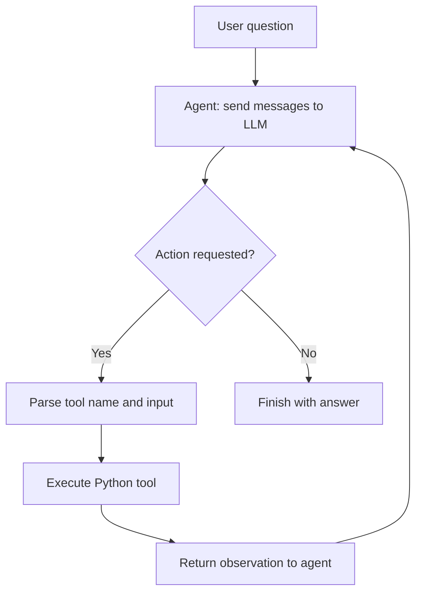

---

# Lesson 1 — Simple ReAct Agent from Scratch

**Course:** [AI Agents in LangGraph — DeepLearning.AI](https://www.deeplearning.ai/courses/ai-agents-in-langgraph)  
**Notebook:** `Lesson_1_Student(1).ipynb`  
**Goal:** Understand the mechanics of a tool-using AI agent *before* introducing LangGraph.

## 1. What is the ReAct pattern?

The notebook constructs a simple agent that alternates between asking a language model what to do and running a Python function on its behalf. The system prompt specifies the following text-based sequence:

1. **Thought:** The model indicates what it plans to do.
2. **Action:** The model requests one of the available tools.
3. **PAUSE:** The model stops and awaits the tool result.
4. **Observation:** Python executes the requested tool and sends its result back.
5. **Answer:** The model provides the final response when it no longer needs a tool.

> **Key point:** The LLM **does not execute Python tools itself**. Our Python code identifies a requested action, runs the corresponding function, and returns its output as an observation.



## 2. Setup and a first LLM call

The notebook imports `openai`, `re`, `httpx`, `os`, and `load_dotenv`; it uses `load_dotenv()` to load local environment variables and initializes the OpenAI client.

```python
from dotenv import load_dotenv
from openai import OpenAI

load_dotenv()
client = OpenAI()

chat_completion = client.chat.completions.create(
    model="gpt-3.5-turbo",
    messages=[{"role": "user", "content": "Hello world"}]
)
print(chat_completion.choices[0].message.content)
```

The `messages` list specifies conversation turns. The response text is accessed via `choices[0].message.content`. The notebook subsequently uses `gpt-4o` inside its custom agent class.

**Run locally:** install the packages needed by the notebook and put `OPENAI_API_KEY` in your environment or a local `.env` file. Do not commit the `.env` file to GitHub.

```bash
pip install openai python-dotenv httpx
```

## 3. Build an `Agent` class

```python
class Agent:
    def __init__(self, system=""):
        self.system = system
        self.messages = []
        if self.system:
            self.messages.append({"role": "system", "content": system})

    def __call__(self, message):
        self.messages.append({"role": "user", "content": message})
        result = self.execute()
        self.messages.append({"role": "assistant", "content": result})
        return result

    def execute(self):
        completion = client.chat.completions.create(
            model="gpt-4o",
            temperature=0,
            messages=self.messages
        )
        return completion.choices[0].message.content
```

**How it works:**

- `__init__`: stores the system prompt and starts conversation history.
- `__call__`: enables `bot("question")`, adds the new input to history, calls the model, and saves its response.
- `execute`: sends the accumulated `messages` to the model and returns its text.
- `temperature=0`: requests less random output; it does not guarantee perfectly deterministic responses.

**Important distinction:** This class manages the conversation, but does **not** yet automatically run any tools. That comes later in `query()`.

## 4. Describe the available actions in the prompt

The system prompt instructs the model to follow `Thought → Action → PAUSE → Observation → Answer` and advertises two possible actions:

```text
calculate: 4 * 7 / 3
average_dog_weight: Collie
```

It also supplies an example interaction: a question about a Bulldog causes the model to request `average_dog_weight`, and an observation supplies the weight before the final answer.

The format of the action line matters: the Python loop later uses a regular expression to locate lines beginning with `Action:`.

## 5. Define actual Python tools

The notebook defines two functions:

```python
def calculate(what):
    return eval(what)


def average_dog_weight(name):
    if name in "Scottish Terrier":
        return "Scottish Terriers average 20 lbs"
    elif name in "Border Collie":
        return "a Border Collies average weight is 37 lbs"
    elif name in "Toy Poodle":
        return "a toy poodles average weight is 7 lbs"
    else:
        return "An average dog weights 50 lbs"

known_actions = {
    "calculate": calculate,
    "average_dog_weight": average_dog_weight
}
```

`known_actions` maps each tool name to a callable Python function. The model can *request* a named action; Python chooses which function to run by looking up that name in the dictionary.

> **Security note (additional implementation guidance):** `eval()` is used for demonstration, but executing model-generated expressions with unrestricted `eval()` is unsafe. For a real application, replace it with a restricted arithmetic parser/calculator and validate the inputs. The dog-weight matching logic is also simplified instructional code, not a reliable general lookup.

## 6. Run a single tool call manually

The notebook creates an agent with the ReAct prompt:

```python
abot = Agent(prompt)
result = abot("How much does a toy poodle weigh?")
print(result)
```

Then Python runs the tool separately and sends its output back:

```python
result = average_dog_weight("Toy Poodle")
next_prompt = "Observation: {}".format(result)
abot(next_prompt)
```

Here the notebook **manually** supplies the observation; it is not yet dynamically detecting and executing a requested action. You can inspect `abot.messages` to see that the previous conversation is preserved.

## 7. Multi-step example: combined dog weight

The next question is:

> I have 2 dogs, a border collie and a scottish terrier. What is their combined weight?

The notebook manually walks through the observations:

1. `average_dog_weight("Border Collie")` → **37 lbs**
2. `average_dog_weight("Scottish Terrier")` → **20 lbs**
3. `eval("37 + 20")` → **57**

The example illustrates how multiple tool results can be used to reach a final answer, and why the agent needs a loop rather than a single LLM call.

## 8. Automate the agent loop

### Parse requested actions

```python
import re

action_re = re.compile(r'^Action: (\w+): (.*)$')
```

For an output line such as `Action: calculate: 37 + 20`, this pattern captures:

- Action name: `calculate`
- Action input: `37 + 20`

### Execute requested actions and feed observations back

```python
def query(question, max_turns=5):
    i = 0
    bot = Agent(prompt)
    next_prompt = question
    while i < max_turns:
        i += 1
        result = bot(next_prompt)
        print(result)
        actions = [
            action_re.match(a)
            for a in result.split('\n')
            if action_re.match(a)
        ]
        if actions:
            action, action_input = actions[0].groups()
            if action not in known_actions:
                raise Exception("Unknown action: {}: {}".format(action, action_input))
            print(" -- running {} {}".format(action, action_input))
            observation = known_actions[action](action_input)
            print("Observation:", observation)
            next_prompt = "Observation: {}".format(observation)
        else:
            return
```

**What changes compared with the manual example?**

1. Calls the model via `bot(next_prompt)`.
2. Searches the model response for an `Action:` line.
3. Looks up the named tool in `known_actions`.
4. Runs the Python function and gets an observation.
5. Passes `Observation: ...` back on the next turn.
6. Stops when no action line is detected, or when `max_turns` is reached.

The notebook tests the automated loop with the same two-dog question:

```python
question = """I have 2 dogs, a border collie and a scottish terrier. \
What is their combined weight"""
query(question)
```

**Implementation detail:** The notebook's `query()` prints intermediate responses and returns `None` rather than returning the final answer as a value. It also executes only the *first* matched action in each turn. These are simplifications of the teaching example.

## 9. Key takeaways

- A **ReAct agent** alternates between model output and external tool execution.
- A **system prompt** describes the actions and the text format the model should use.
- The **conversation history (`messages`)** gives the model context across iterations.
- The **LLM selects a tool**, while **Python actually executes it**.
- **Observations** allow the next model call to use information returned by tools.
- A **loop** enables multi-step tasks; `max_turns` prevents unlimited iterations.
- This lesson implements the control flow manually; later LangGraph lessons introduce a framework for representing and managing such workflows.

## 10. Quick self-check

1. Why does `Agent.__call__()` append both user and assistant messages?
2. What happens if the model asks for a tool missing from `known_actions`?
3. Why does the agent need an observation before continuing?
4. What role does `action_re` play?
5. What is the difference between the manual dog-weight example and `query()`?
6. Why should unrestricted `eval()` be avoided in a real agent?

**One-sentence summary:** *An AI agent is more than an LLM call: it combines a model, tools, conversation state, and control logic to perform multi-step tasks.*
