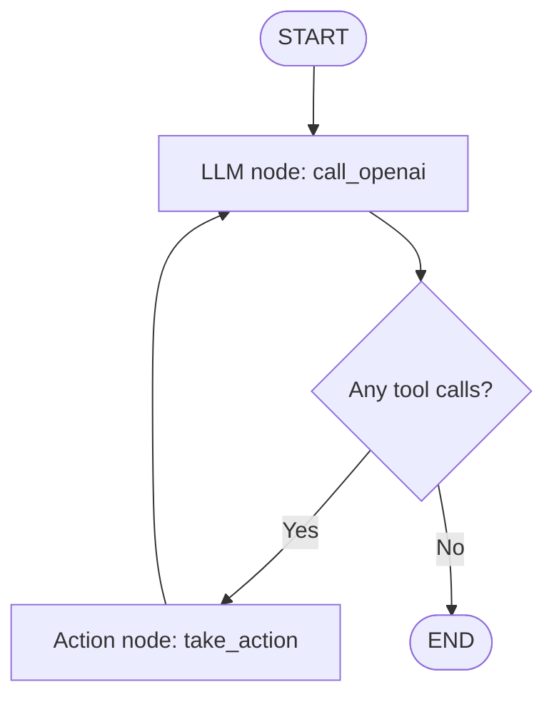

Lesson 2: LangGraph Components
Course: AI Agents in LangGraph — DeepLearning.AI
Notebook: Lesson_2_Student.ipynb
Focus: Building a tool-using AI agent with LangGraph

Overview
In this lesson, I explored the building blocks of LangGraph by creating a research assistant that can call a web search tool, process its results, and return an answer. Unlike a single LLM call, this agent can loop between reasoning and tool execution until it has enough information to respond.
Learning Objectives
- Understand state, nodes, edges, and conditional edges in LangGraph.
- Define an agent's state using Python's TypedDict and Annotated.
- Build a graph with StateGraph and compile it.
- Bind a search tool to an OpenAI chat model.
- Route between an LLM node and a tool-execution node.
- Run the agent on single-search and multi-step questions.
Agent Workflow

The LLM can answer directly or request a tool call. If a tool is requested, the action node runs it and passes the result back into the conversation state. The LLM then decides whether to search again or finish.
Core LangGraph Concepts
Component	Implementation	Role
State	AgentState	Stores the messages exchanged during execution
State reducer	Annotated[list[AnyMessage], operator.add]	Appends new messages to the current message list
Graph	StateGraph(AgentState)	Defines the workflow
LLM node	call_openai()	Invokes the model with conversation messages
Action node	take_action()	Executes requested tool calls and returns ToolMessage objects
Conditional routing	exists_action()	Checks the latest model message for tool calls
Loop	graph.add_edge('action', 'llm')	Returns tool output to the model
Compiled graph	graph.compile()	Produces an executable graph

1. Define the agent state
class AgentState(TypedDict):
    messages: Annotated[list[AnyMessage], operator.add]
- TypedDict specifies the structure of the state.
- AnyMessage allows the list to contain different LangChain message types.
- operator.add is a reducer: it combines the existing list with incoming messages rather than replacing it.
2. Build the graph
The notebook's Agent class creates two nodes, llm and action, and connects them with conditional routing:
graph = StateGraph(AgentState)
graph.add_node("llm", self.call_openai)
graph.add_node("action", self.take_action)
graph.add_conditional_edges(
    "llm", self.exists_action,
    {True: "action", False: END}
)
graph.add_edge("action", "llm")
graph.set_entry_point("llm")
self.graph = graph.compile()
The key insight is that the graph doesn't always run every node. It selects the next step based on whether the LLM requested a tool.
3. Bind tools to the model
self.tools = {t.name: t for t in tools}
self.model = model.bind_tools(tools)
bind_tools() gives the model the tool specifications so it can request a tool call. It does not execute the tool itself; the take_action() node performs the execution.
4. Detect and execute tool calls
exists_action() checks state['messages'][-1].tool_calls. If this list is nonempty, execution goes to the action node. take_action() executes each requested tool and adds a corresponding ToolMessage to state.

The notebook also handles an unknown tool name by returning a message asking the model to retry. This illustrates a simple recovery mechanism, though it is not a complete production error-handling system.
Tools and Models Used
- LangGraph: Graph-based agent orchestration
- LangChain / LangChain Core: Message types and model/tool interfaces
- OpenAI (ChatOpenAI): LLM used to make decisions and formulate answers
- Tavily Search (TavilySearchResults): Web search tool, configured with max_results=4
- python-dotenv: Loads environment variables from .env
The notebook uses gpt-3.5-turbo for the initial examples and gpt-4o for the more complex research question. These are the model identifiers in the course notebook; availability may vary.
Practical Examples
Example 1 — One-city weather query
What is the weather in sf?

Example 2 — Multi-city weather query
What is the weather in SF and LA?

Example 3 — Multi-step research question
Who won the super bowl in 2024? In what state is the winning team headquarters located? What is the GDP of that state? Answer each question.

The third question demonstrates why an agent may need to perform several linked lookups before forming its final response. Live results may vary depending on the model and search results.
Running the Notebook
1. Create and activate a Python virtual environment.
2. Install the notebook's dependencies:
   pip install langgraph langchain-core langchain-openai langchain-community tavily-python python-dotenv jupyter
3. Create a .env file in your working directory and supply your own API keys:
   OPENAI_API_KEY=your_openai_api_key
   TAVILY_API_KEY=your_tavily_api_key
4. Start Jupyter and open the notebook:
   jupyter notebook Lesson_2_Student.ipynb
5. Run the cells in order to create the graph and test the sample questions.
Security: Never commit .env files or API keys to GitHub. Add .env to .gitignore. The notebook uses course-era imports; depending on installed package versions, you may need to adapt deprecated integrations.

Key Takeaways
1. State is the shared data carried through the graph; reducers control how updates are combined.
2. Nodes perform work, while edges determine what runs next.
3. Conditional edges let the agent choose between using tools and returning an answer.
4. Tool binding is not tool execution: the model requests an action, and a Python node executes it.
5. Loops enable multi-step behavior: after seeing tool results, the agent can decide to call another tool.
6. Tool calls can be imperfect: handling invalid tool names is one small example of agent resilience.
Next Steps
Explore richer tools, persistence, streaming, and human-in-the-loop workflows in later lessons.
Learning notes based on the DeepLearning.AI course notebook. Documented as part of my hands-on LangGraph learning journey.
